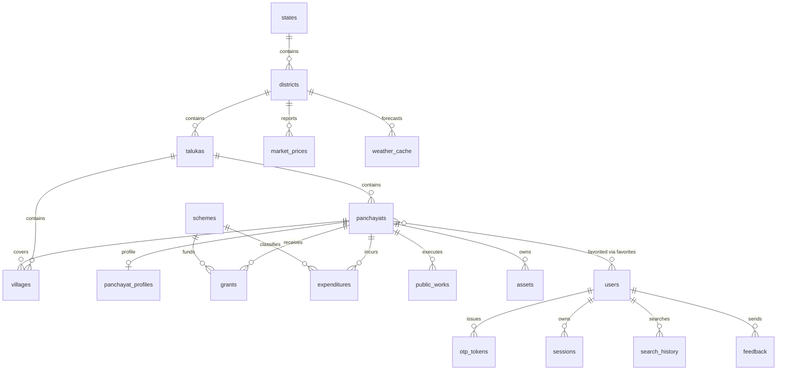

# GramLedger — Database

PostgreSQL schema for GramLedger (target: [Neon](https://neon.tech), raw
Postgres). Every change is a versioned SQL migration managed by
`node-pg-migrate`. This document is the schema reference: table purposes,
relationships, indexing strategy, and workflow.

Related docs: [PLANNING.md](../docs/PLANNING.md) §5 (design intent),
[DEVELOPMENT.md](../DEVELOPMENT.md) (commands), [AGENTS.md](../AGENTS.md)
(constraints).

## Domains

| Domain     | Tables                                                                                                                |
| ---------- | --------------------------------------------------------------------------------------------------------------------- |
| Reference  | `states`, `districts`, `talukas`, `villages`, `panchayats`                                                            |
| Governance | `schemes`, `panchayat_profiles`, `grants`, `expenditures`, `public_works`, `assets`, `market_prices`, `weather_cache` |
| Users      | `users`, `otp_tokens`, `sessions`, `favorites`, `search_history`, `feedback`                                          |
| ETL audit  | `ingestion_runs`, `ingestion_snapshots`                                                                               |

## Conventions

- **Names**: snake_case; plural tables, singular columns; `fk_<table>_<column>`,
  `uq_<table>_<key>`, `idx_<table>_<columns>`, `ck_<table>_<column>`.
- **Money**: `numeric(14,2)` (INR) for governance amounts, `numeric(12,2)` for
  market prices (₹/quintal). Money columns have `>= 0` CHECKs.
- **Timestamps**: `timestamptz` for instants (`created_at`, `updated_at`,
  `started_at`, …); `date` for calendar dates (`price_date`, `disbursed_at`).
- **Financial year**: `fy integer` = fiscal year start (2024 ⇒ FY 2024-25);
  CHECK `BETWEEN 2000 AND 2100`. Sortable and compact vs `'2024-25'` text.
- **Ids**: surrogate `bigint GENERATED ALWAYS AS IDENTITY` for public
  reference/governance tables; `uuid` (via built-in `gen_random_uuid()`) for
  user tables so opaque ids do not leak counts or ordering.
- **Natural keys**: hierarchy rows are keyed by `lgd_code UNIQUE`; money rows by
  `UNIQUE(panchayat_id, fy, scheme_id[, head])` — these power idempotent ETL
  upserts (`ON CONFLICT`) and double as lookup indexes. `lgd_code` is `bigint`
  (LGD codes can exceed `integer` range).
- **No business logic**: no triggers, no stored procedures. Validation belongs
  to the API/ETL layers; constraints here are structural integrity only.

## Reference / hierarchy

Administrative geography from the LGD (Local Government Directory) dataset.

- **`states`** — top-level state. (`lgd_code`, `name_mr`, `name_en`.)
- **`districts`** — child of a state.
- **`talukas`** — child of a district (≈ block / tehsil in Maharashtra).
- **`panchayats`** — Panchayat Raj Institutions. `level` ∈ `gram | block |
district` (Gram Panchayat / Panchayat Samiti / Zilla Parishad). Carries
  denormalized `state_id/district_id/taluka_id` for cheap filtered search.
  `geojson_polygon_id` is a forward-compatible slot for a future GIS table (no
  FK yet — GIS is deferred).
- **`villages`** — child of a taluka, optionally mapped to a Gram Panchayat
  (`panchayat_id`, nullable until the LGD mapping is backfilled).

## Governance

- **`schemes`** — curated catalog of government schemes (`code` unique).
- **`panchayat_profiles`** — 1:1 with a panchayat; sarpanch/secretary/contacts +
  `elected_committee jsonb`, `updated_at`.
- **`grants`** — money-in. Natural key `(panchayat_id, fy, scheme_id)`.
- **`expenditures`** — money-out per scheme _head_. Natural key
  `(panchayat_id, fy, scheme_id, head)`.
- **`public_works`** — works (`title`, `status`, amounts, dates, `geo_tag jsonb`).
  `status` is free text on purpose (portal values vary across states/years).
- **`assets`** — GP asset register (sparse; maintained by the panchayat).
- **`market_prices`** — daily Agmarknet prices. Natural key
  `(market, commodity, variety, price_date)`; `variety` defaults to `''` so the
  dedupe key is reliable when a variety is absent.
- **`weather_cache`** — IMD forecast cache, PK `(district_id, issued_at)`.

## Users

- **`users`** — email, optional name, locale (`mr` default). Email uniqueness
  is case-insensitive via `uq_users_email_lower`; the API must query
  `WHERE lower(email) = lower($1)`.
- **`otp_tokens`** — hashed OTP codes only (`hashed_code`), per-user attempt
  counter, expiry. (Raw OTP never stored.)
- **`sessions`** — hashed refresh tokens (`token_hash` unique), `revoked` flag.
- **`favorites`** — user ↔ panchayat join (PK `(user_id, panchayat_id)`).
- **`search_history`** — per-user query log.
- **`feedback`** — user feedback; `user_id` nullable (anonymous allowed).

## ETL audit

- **`ingestion_runs`** — one row per pipeline run: source, status
  (`running|success|partial|failed`), row counts, `errors jsonb`, timings.
- **`ingestion_snapshots`** — pointer to a pre-overwrite snapshot in object
  storage (`s3_key` unique).

## ER diagram



## Indexing strategy

Optimised for the five hot access patterns:

| Pattern                            | Index(es)                                                                                                                                                             |
| ---------------------------------- | --------------------------------------------------------------------------------------------------------------------------------------------------------------------- |
| **Panchayat search**               | GIN trigram on `panchayats.name_en`, `panchayats.name_mr`, `villages.name_en`, `villages.name_mr`                                                                     |
| **Hierarchy drill-down**           | `districts(state_id)`, `talukas(district_id)`, `panchayats(state/district/taluka_id)`, `villages(taluka_id)`                                                          |
| **Finance lookup (per panchayat)** | Covered by the natural-key UNIQUE indexes: `grants(panchayat_id, fy, scheme_id)`, `expenditures(panchayat_id, fy, scheme_id, head)`; `public_works(panchayat_id, fy)` |
| **Scheme lookup**                  | `schemes(code)` unique + GIN trigram on `schemes.name_en`                                                                                                             |
| **Market prices**                  | `market_prices(commodity, price_date)`, `market_prices(district_id, price_date)`                                                                                      |
| **ETL imports**                    | Natural-key unique indexes (upsert targets); `ingestion_runs(source, started_at)`, `ingestion_snapshots(source, taken_at)`                                            |
| **User favorites / history**       | PK `favorites(user_id, panchayat_id)` + `idx_favorites_panchayat_id`; `search_history(user_id, created_at DESC)`                                                      |

Notes:

- Trigram search uses **GIN** (`gin_trgm_ops`), not GiST as sketched in
  PLANNING.md §5 — GIN is the recommended index type for `pg_trgm` and reads
  faster on high-cardinality name columns.
- Both scripts are indexed because Marathi is the default UI locale.
- Where PLANNING.md §5 lists `(panchayat_id, fy)` / `(panchayat_id, scheme_id)`
  on `grants`/`expenditures`, those are leftmost prefixes of the natural-key
  UNIQUE indexes, so no extra indexes are needed.

## Search

- `pg_trgm` extension (migration `extensions`).
- ILIKE trigram matching against `name_en` / `name_mr` via the GIN indexes
  above. Query construction is the API layer's job — no search queries here.

## Migration workflow

```bash
# Scaffold a new migration (SQL file in migrations/, no DB needed)
npm run db:migrate:create -- <describe-the-change>

# Apply to the dev database (DATABASE_URL in database/.env)
npm run db:migrate            # up
npm run db:migrate:down       # roll back the last migration

# Apply to the test database (DATABASE_URL in database/.env.test)
npm run db:migrate:test       # up
```

- One concern per migration file, timestamped by `node-pg-migrate`.
- Every migration has an up **and** a down (drop in reverse FK order).
- `CREATE EXTENSION` / seed statements use `IF NOT EXISTS` / `ON CONFLICT
DO NOTHING` so they are idempotent.
- Never edit an applied migration — add a new one.
- `node-pg-migrate` tracks applied migrations in the `pgmigrations` table.

## Seed framework

- `database/seeds/*.sql`, run in filename order by `npm run db:seed`
  (via `scripts/seed.sh` → `psql`).
- Seeds are **idempotent** (`ON CONFLICT DO NOTHING`) and wrapped in a
  transaction where multiple statements are related.
- `seeds/hierarchy_sample.sql` loads a **sample** Maharashtra hierarchy
  (5 districts, 11 talukas, 8 panchayats, 10 villages). The LGD codes are
  placeholders — the LGD ETL pipeline replaces this with authoritative data
  before public launch.
- Seeds hold reference/curated data only; transactional data belongs to ETL.

## Configuration

| Use  | File                 | Env var        | Loaded by                               |
| ---- | -------------------- | -------------- | --------------------------------------- |
| Dev  | `database/.env`      | `DATABASE_URL` | `npm run db:migrate`, `npm run db:seed` |
| Test | `database/.env.test` | `DATABASE_URL` | `npm run db:migrate:test`               |

Templates: `.env.example`, `.env.test.example`. Both are gitignored; copy the
template and fill in your connection string (local Postgres or a Neon branch).

`scripts/run-migrate.sh` sources the env file then execs `node-pg-migrate`, so
dev and test can target different databases without touching each other's env.

## Design decisions & improvements over PLANNING.md

1. **`fy` as integer** (start year) instead of `'2024-25'` text — sortable,
   range-cheap, space-cheap.
2. **GIN over GiST trigram indexes** — recommended index type for `pg_trgm`.
3. **Dropped redundant `(panchayat_id, fy)` / `(panchayat_id, scheme_id)`
   indexes** on `grants`/`expenditures` — leftmost prefixes of the natural-key
   unique indexes already serve those lookups.
4. **`scheme_id NOT NULL`** on `grants`/`expenditures` — keeps natural-key
   upserts reliable (no NULL-scheme duplicates). ETL upserts `schemes` first.
5. **`variety NOT NULL DEFAULT ''`** on `market_prices` — reliable dedupe when
   the source omits a variety.
6. **Case-insensitive email uniqueness** via `uq_users_email_lower` instead of a
   plain `UNIQUE(email)`.
7. **`uuid` user ids** — no sequential user enumeration via JWTs/links.
8. **`public_works.status` free text** (no CHECK) — external portal values vary;
   a CHECK would abort whole ETL batches.
9. **Canonical ETL `source` names** enforced by CHECK on ingestion tables.
10. **Dev/test split** (`run-migrate.sh` + `.env.test`) so migrations can be
    verified against a scratch database before touching dev.

## Open items

- Backfill authoritative LGD hierarchy (replace sample seed) via the LGD ETL.
- `geojson_polygon_id` FK when the GIS table lands (Phase 2/3).
- Postgres client choice for the API (postgres.js vs @neondatabase/serverless).
